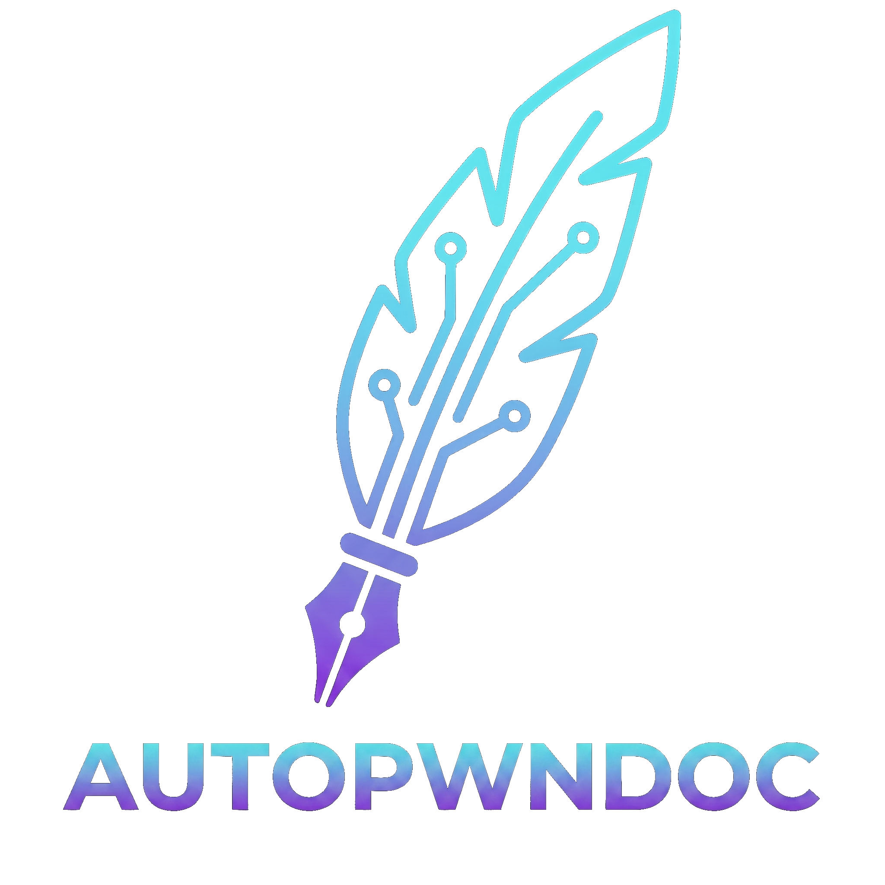

# AutoPwnDoc



**AutoPwnDoc** is an AI-powered pentest report generation tool, built as a master's thesis project on top of [PwnDoc-ng](https://github.com/pwndoc-ng/pwndoc-ng) (itself a maintained fork of the original [PwnDoc](https://github.com/pwndoc/pwndoc) by [yeln4ts](https://github.com/yeln4ts)).

The core goal remains the same - more time to **Pwn**, less time to **Doc** - but AutoPwnDoc takes it further by integrating AI assistance directly into the reporting workflow: from generating finding descriptions to analysing proof screenshots and writing executive summaries.

---

## What's New vs PwnDoc-ng

### AI features

- **In-editor AI toolbar** - generate, complete, and rewrite any finding field (description, observation, remediation, proof, retest evidence) with one click, powered by any OpenAI-compatible provider.
- **RAG-augmented generation** - ChromaDB vector store indexes the vulnerability library; when writing a finding, the AI retrieves semantically similar past vulnerabilities as context.
- **Semantic similarity search** - find related vulnerabilities from the library while editing a finding; apply fields selectively with a two-panel diff dialog.
- **Multimodal proof analysis** - the AI reads proof-of-concept screenshots and generates a structured observation/evidence narrative.
- **Executive summary AI assist** - per-severity summaries and overall executive summary generated from the audit's findings digest.
- **Configurable prompts** - every AI action has a configurable system prompt; field-level overrides allow different prompts per field per action.
- **Multiple provider support** - OpenAI, Anthropic, Ollama, Azure OpenAI, and any OpenAI-compatible endpoint (e.g. Open WebUI, LM Studio).

### Retest support

- Audits can be flagged as retests (`isRetest`).
- Findings gain a **Retest Evidence** tab and a `retestStatus` outcome (`ok` / `ko` / `partial` / `unknown`).
- Dedicated report template variables: `audit.is_retest`, `finding.retest_evidence`, `finding.retest_status` (plus the legacy `finding.retest_passed` boolean alias).

### Executive summary section

- New audit section with overall risk picker, summary editor, and per-severity (Critical → Informative) text blocks.
- All blocks support the AI assist workflow.
- Exposed in DOCX templates as `audit.overall_risk`, `audit.executive_summary`, `audit.{severity}_summary`.

### Native MCP server

- Exposes a JSON-RPC 2.0 **Model Context Protocol** endpoint at `POST /api/mcp` (Streamable HTTP, protocol `2025-03-26`).
- Lets AI agents (e.g. Claude Desktop) read and write audits, findings, and vulnerabilities directly.
- Secured with an API key managed in the Settings page (rotate/clear).
- 27 tools covering audits, findings, vulnerability lookup, and Tools/Licenses/Guides CRUD. Workspace operations are `list_tools`, `create_tool`, `update_tool`, `delete_tool`, `list_licenses`, `create_license`, `update_license`, `delete_license`, `list_guides`, `get_guide`, `create_guide`, `update_guide`, and `delete_guide`.

### Granular user permissions

- Users have a base role (`user` / `admin`) plus an optional per-permission extra-grant array.
- Permissions are merged into the JWT at login and take effect immediately on the next token refresh.
- UI: checkbox grid in the collaborators page grouped by five permission categories.

### Inherited from PwnDoc-ng

- TipTap 3 WYSIWYG editor with collaborative editing (Hocuspocus WebSocket)
- Table support, syntax highlighting (CSS, JS, HTTP, TS, HTML, Bash, SQL, JSON)
- Bar and pie charts in reports
- Integrated spellchecker (LanguageTool via the backend proxy)
- CVSS 3.1 + 4.0 calculator
- Reviewer workflow and approval states
- Custom sections and custom fields
- Multi-language / multi-locale report generation

---

## Features at a Glance

| Category | Capability |
|---|---|
| Report generation | Customisable DOCX via docxtemplater |
| AI assistance | Generate / complete / rewrite any field |
| AI providers | OpenAI, Anthropic, Ollama, Azure OpenAI, OpenAI-compatible |
| Semantic search | ChromaDB RAG over vulnerability library |
| Proof analysis | Vision LLM reads screenshots → narrates evidence |
| Collaboration | Real-time multi-user editing (WebSocket) |
| MCP server | AI agent access via JSON-RPC 2.0 |
| Retest support | Retest evidence tab + ok/ko/partial/unknown outcome per finding |
| Permissions | Role-based + per-permission granular grants |
| Spellcheck | LanguageTool integration in editor |
| Localisation | EN, ES, DE report and UI locales |

---

## Template demo

| Example template | Generated document |
|---|---|
|  |  |

---

## Quick start (development)

```bash
docker compose -f docker-compose-dev.yml up
```

The app is served at `https://localhost:8443`.

Default credentials: `admin` / `Admin1admin2`

### Seed test data

```bash
TOKEN=$(curl -sk -X POST https://localhost:8443/api/users/token \
  -H "Content-Type: application/json" \
  -d '{"username":"admin","password":"Admin1admin2"}' | jq -r '.datas.token')

# Languages must be added before vulnerabilities
curl -sk -X POST https://localhost:8443/api/data/languages \
  -H "Content-Type: application/json" -H "Cookie: token=JWT $TOKEN" \
  -d '{"language":"English","locale":"en-GB"}'

# 10 canonical test vulnerabilities
curl -sk -X POST https://localhost:8443/api/vulnerabilities \
  -H "Content-Type: application/json" -H "Cookie: token=JWT $TOKEN" \
  -d @backend/tests/fixtures/test-vulnerabilities.json
```

### Production database persistence

Production uses `backend/mongo-data` as the MongoDB ground truth. This bind-mounted
directory survives Compose project-name changes and `docker compose down -v`.
Development keeps a separate named volume because WiredTiger bind mounts are not
reliable on Docker Desktop for Windows.

Use the root-level operational commands:

```bash
sh ./backup-database.sh       # timestamped logical backup
sh ./migrate-database.sh      # one-time named-volume migration
sh ./update-production.sh     # backup, pull, migrate, build, and health-check
```

See `docs/installation.md` for first-install, archive restore, and recovery
instructions.

---

## Lineage

```
PwnDoc (yeln4ts)
  └── PwnDoc-ng (pwndoc-ng/pwndoc-ng)
        └── AutoPwnDoc (this repo) - AI features, MCP server, retest, executive summary
```

---

## Licence

This project inherits the licence of the upstream repositories. See `LICENSE` for details.
